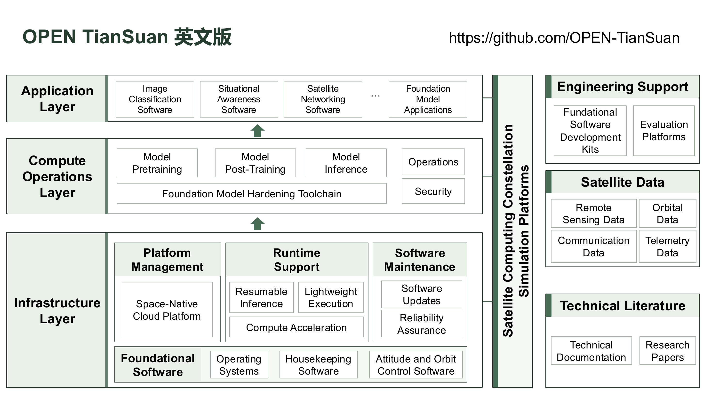

# 🛰️ OPEN TianSuan: Open Source Community for Space

**Open satellite software, resources, and knowledge.**

An open-source community called OPEN TianSuan, focused on satellite computing, software, applications, and open collaboration.

 

---

## 🌍 Why Open Source?

Satellite development sits at the intersection of aerospace, communications, and computing, and each part demands deep, specialized expertise. As constellations scale and computation moves into orbit, no single lab or company can master it all alone. Progress depends on **shared code, shared data, and shared lessons**, and that is exactly what open source does best.

As [our ASE 2026 study](https://doi.org/10.1145/3832783.3834343) of the open-source satellite software landscape shows, open source has already proven itself in space. Flight software frameworks such as NASA's [cFS](https://github.com/nasa/cFS) and JPL's [F´](https://github.com/nasa/fprime) have flown on dozens of missions, from CubeSats to the Ingenuity Mars Helicopter; open simulation platforms let anyone model orbits, constellations, and onboard workloads without launching anything; community ground station networks like [SatNOGS](https://satnogs.org/) span the globe; and in-orbit experiment platforms such as the [Tiansuan Constellation](http://www.tiansuan.org.cn/) initiated by BUPT now open the code, data, and systems of real satellites to researchers everywhere. **Yet the ecosystem is still in its early days**: resources are scattered across communities, shared datasets and benchmarks are scarce, ready-to-run onboard applications are rare, and published results are hard to reproduce.

**That is why OPEN TianSuan exists**: to lower the barrier to satellite computing by gathering papers, datasets, tools, and runnable software in one open place, so that anyone can learn, reproduce, and build on each other's work.

---

## 🚀 Explore OPEN TianSuan

  

中文版

  

### 🧩 [ApplicationLayer](https://github.com/OPEN-TianSuan/ApplicationLayer)

Satellite application software built around the ten App1–App10 cases from the SateLight update framework, spanning perception, situational awareness, networking, and foundation-model applications.

### ⚙️ [ComputeOperationsLayer](https://github.com/OPEN-TianSuan/ComputeOperationsLayer)

Compute operations for satellite computing, from model pretraining and post-training through inference, hardening, operations, and security.

### 🏗️ [InfrastructureLayer](https://github.com/OPEN-TianSuan/InfrastructureLayer)

Satellite infrastructure software, from platform management and runtime support to software maintenance and foundational software.

### 🛠️ [EngineeringSupport](https://github.com/OPEN-TianSuan/EngineeringSupport)

Engineering support for satellite software, with foundational software development kits and evaluation platforms.

- **[Foundational Software Development Kits](https://github.com/OPEN-TianSuan/EngineeringSupport/tree/main/FoundationalSoftwareDevelopmentKits)** gathers frameworks, libraries, and toolchain projects.
- **[Evaluation Platforms](https://github.com/OPEN-TianSuan/EngineeringSupport/tree/main/EvaluationPlatforms)** collects platforms for benchmarking and evaluation.

### 🛰️ [SimulationPlatform](https://github.com/OPEN-TianSuan/SimulationPlatform)

Open-source platforms for simulating satellite computing constellations.

- **[Satellite communication networks and protocols](https://github.com/OPEN-TianSuan/SimulationPlatform#satellite-communication-networks-and-protocols)** covers constellation networking and protocol simulation.
- **[Orbital analysis and mission dynamics](https://github.com/OPEN-TianSuan/SimulationPlatform#orbital-analysis-and-mission-dynamics)** covers orbit and mission analysis.
- **[RF, SDR, and electromagnetic simulation](https://github.com/OPEN-TianSuan/SimulationPlatform#rf-sdr-and-electromagnetic-simulation)** covers radio and electromagnetic modelling.

### 🗂️ [SatelliteData](https://github.com/OPEN-TianSuan/SatelliteData)

Satellite data collections spanning imagery, orbits, telemetry, and communication links.

- **[Remote Sensing Imagery](https://github.com/OPEN-TianSuan/SatelliteData/tree/main/RemoteSensingImagery)** curates open datasets and data-access platforms.
- **[Orbital Data](https://github.com/OPEN-TianSuan/SatelliteData/tree/main/OrbitalData)** collects orbital products such as TLE sets and ephemerides.
- **[Telemetry Data](https://github.com/OPEN-TianSuan/SatelliteData/tree/main/TelemetryData)** shares satellite telemetry and collection notes.
- **[Communication Data](https://github.com/OPEN-TianSuan/SatelliteData/tree/main/CommunicationData)** provides communication data and link measurements.

### 📄 [TechnicalLiterature](https://github.com/OPEN-TianSuan/TechnicalLiterature)

Reference material on satellite systems, from peer-reviewed research to standards and technical reports.

- **[Research Papers](https://github.com/OPEN-TianSuan/TechnicalLiterature/tree/main/ResearchPapers)** indexes papers from top conferences and journals.
- **[Technical Documentation](https://github.com/OPEN-TianSuan/TechnicalLiterature/tree/main/TechnicalDocumentation)** brings together standards, specifications, research reports, and engineering guidelines.

Our repositories are continuously updated with new resources, tools, and projects.

---

## 💬 Discussions

We use **GitHub Discussions** for community communication and knowledge sharing.

**We regularly share:**  
📢 Project updates · 📚 Research & knowledge · 🔧 Open-source tools · 🛰️ Satellite resources

Have an idea, request, or useful project to share?  
Feel free to start a discussion.

You are also welcome to introduce your own **satellite-related tools, software, datasets, research projects, or open-source work**.

👉 **[Join the Discussions](https://github.com/orgs/OPEN-TianSuan/discussions)**

---

## 🤝 Contributing

Researchers, developers, students, and satellite enthusiasts are welcome to contribute through:

**Ideas & Requests** · **Resource Recommendations** · **Open-Source Projects** · **Issues & Improvements** · **Code Contributions**

---

**Explore · Share · Build for Space 🛰️**

