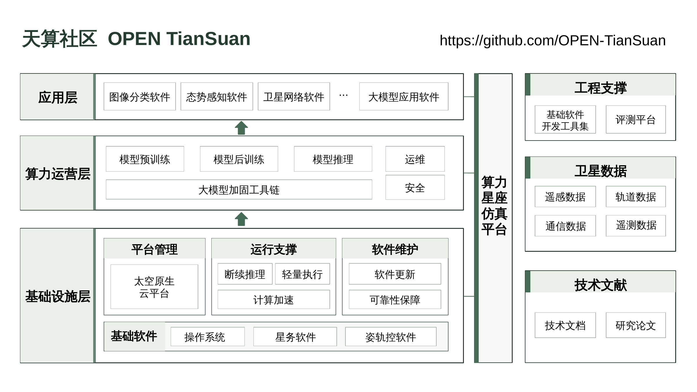

# 🛰️ OPEN TianSuan

### Open-Source Community for Space Computing

**Discover open technologies. Reuse proven ideas. Build for space.**

A community for satellite software, computing platforms, engineering resources, open datasets, and research knowledge.

---

## 🌍 Why OPEN TianSuan?

Space computing brings together aerospace, communications, and computer science. As satellite constellations expand and computing moves into orbit, software must span spacecraft platforms, onboard execution, communication networks, and mission applications. These challenges cross disciplines and organizations. **Shared implementations, data, and experimental knowledge help researchers reproduce results and build on one another's work.**

Our [ASE 2026 study](https://doi.org/10.1145/3832783.3834343) surveys the open-source satellite software landscape. Projects such as NASA's [cFS](https://github.com/nasa/cFS), JPL's [F'](https://github.com/nasa/fprime), and the community ground-station network [SatNOGS](https://satnogs.org/) demonstrate the value of reusable software and open collaboration. Initiatives such as the [Tiansuan Constellation](http://www.tiansuan.org.cn/) also help extend opportunities for research involving real spacecraft.

Yet the ecosystem remains fragmented: software and documentation are scattered, shared datasets and benchmarks are limited, and reproducing published experiments can be difficult. **OPEN TianSuan brings these resources together so that more people can discover, reuse, evaluate, and contribute to space computing.**

---

## 🚀 Explore the Ecosystem

OPEN TianSuan organizes open-source resources into seven major areas, covering the satellite software stack, engineering tools, simulation environments, datasets, and technical knowledge.

<strong>🗺️ Community Architecture - English and Chinese</strong>

  

Chinese Architecture

  

### CORE COMPUTING STACK

<table width="100%" border="1" cellpadding="10" cellspacing="0">
<tr>
<td width="1%" bgcolor="#416B4D">&nbsp;</td>
<td width="10%" align="center" bgcolor="#B5CEBA"><h1>01</h1></td>
<td bgcolor="#C5DCC9">
<h2>🧩 Application Layer</h2>

<strong>Mission-facing software</strong> for image classification, situational awareness, satellite networking, and foundation-model applications.

<a href="https://github.com/OPEN-TianSuan/ApplicationLayer"><strong>Explore Application Layer &rarr;</strong></a>

</td>
</tr>
<tr><td colspan="3" bgcolor="#EDF4EE">

<strong>Browse application areas</strong>

 
<table width="100%" border="0" cellpadding="8" cellspacing="6">
<tr>
<td width="50%" bgcolor="#FFFFFF"><strong>Image Classification Software</strong></td>
<td width="50%" bgcolor="#FFFFFF"><strong>Situational Awareness Software</strong></td>
</tr>
 <tr></tr>
<tr>
<td width="50%" bgcolor="#FFFFFF"><strong>Satellite Networking Software</strong></td>
<td width="50%" bgcolor="#FFFFFF"><strong>Foundation Model Applications</strong></td>
</tr>
 <tr></tr>
 <tr>
<td width="50%" bgcolor="#FFFFFF"><strong>Object Detection Software</strong></td>
<td width="50%" bgcolor="#FFFFFF"><strong>...</strong></td>
 </tr>
</table>

</td></tr>
</table>

 

<table width="100%" border="1" cellpadding="10" cellspacing="0">
<tr>
<td width="1%" bgcolor="#416B4D">&nbsp;</td>
<td width="10%" align="center" bgcolor="#B5CEBA"><h1>02</h1></td>
<td bgcolor="#C5DCC9">
<h2>⚙️ Compute Operations Layer</h2>

<strong>Computing workloads and operational capabilities</strong> spanning model training, inference, model hardening, operations, and security.

<a href="https://github.com/OPEN-TianSuan/ComputeOperationsLayer"><strong>Explore Compute Operations Layer &rarr;</strong></a>

</td>
</tr>
<tr><td colspan="3" bgcolor="#EDF4EE">

<strong>Browse 6 resource areas</strong>

 
<table width="100%" border="0" cellpadding="8" cellspacing="6">
<tr>
<td width="50%" bgcolor="#FFFFFF"><a href="https://github.com/OPEN-TianSuan/ComputeOperationsLayer/tree/main/ModelPretraining"><strong>Model Pretraining</strong></a> Foundation-model pretraining resources.</td>
<td width="50%" bgcolor="#FFFFFF"><a href="https://github.com/OPEN-TianSuan/ComputeOperationsLayer/tree/main/ModelPostTraining"><strong>Model Post-Training</strong></a> Post-training methods and implementations.</td>
</tr>
 <tr></tr>
<tr>
<td width="50%" bgcolor="#FFFFFF"><a href="https://github.com/OPEN-TianSuan/ComputeOperationsLayer/tree/main/ModelInference"><strong>Model Inference</strong></a> Inference workloads and implementations.</td>
<td width="50%" bgcolor="#FFFFFF"><a href="https://github.com/OPEN-TianSuan/ComputeOperationsLayer/tree/main/FoundationModelHardeningToolchain"><strong>Foundation Model Hardening Toolchain</strong></a> Methods and tools for model hardening.</td>
</tr>
 <tr></tr>
<tr>
<td width="50%" bgcolor="#FFFFFF"><a href="https://github.com/OPEN-TianSuan/ComputeOperationsLayer/tree/main/Operations"><strong>Operations</strong></a> Operational workflows and management.</td>
<td width="50%" bgcolor="#FFFFFF"><a href="https://github.com/OPEN-TianSuan/ComputeOperationsLayer/tree/main/Security"><strong>Security</strong></a> Security tools and research.</td>
</tr>
</table>

</td></tr>
</table>

 

<table width="100%" border="1" cellpadding="10" cellspacing="0">
<tr>
<td width="1%" bgcolor="#416B4D">&nbsp;</td>
<td width="10%" align="center" bgcolor="#B5CEBA"><h1>03</h1></td>
<td bgcolor="#C5DCC9">
<h2>🏗️ Infrastructure Layer</h2>

<strong>The software foundation for space computing</strong>, bringing together foundational software, platform management, runtime support, and software maintenance.

<a href="https://github.com/OPEN-TianSuan/InfrastructureLayer"><strong>Explore Infrastructure Layer &rarr;</strong></a>

</td>
</tr>
<tr><td colspan="3" bgcolor="#EDF4EE">

<strong>Browse 4 infrastructure areas</strong>

 
<table width="100%" border="0" cellpadding="8" cellspacing="6">
<tr>
<td width="50%" valign="top" bgcolor="#FFFFFF">
<h3>Foundational Software</h3>
Core spacecraft software.
<ul>
<li><a href="https://github.com/OPEN-TianSuan/InfrastructureLayer/tree/main/FoundationalSoftware/OperatingSystems">Operating Systems</a></li>
<li><a href="https://github.com/OPEN-TianSuan/InfrastructureLayer/tree/main/FoundationalSoftware/HousekeepingSoftware">Housekeeping Software</a></li>
<li><a href="https://github.com/OPEN-TianSuan/InfrastructureLayer/tree/main/FoundationalSoftware/AttitudeOrbitControlSoftware">Attitude and Orbit Control Software</a></li>
</ul>
<a href="https://github.com/OPEN-TianSuan/InfrastructureLayer/tree/main/FoundationalSoftware">Explore Foundational Software &rarr;</a>
</td>
<td width="50%" valign="top" bgcolor="#FFFFFF">
<h3>Platform Management</h3>
Space-native cloud platform resources.
<ul>
<li><a href="https://github.com/OPEN-TianSuan/InfrastructureLayer/tree/main/PlatformManagement/SpaceNativeCloudPlatform">Space-Native Cloud Platform</a></li>
</ul>
<a href="https://github.com/OPEN-TianSuan/InfrastructureLayer/tree/main/PlatformManagement">Explore Platform Management &rarr;</a>
</td>
</tr>
 <tr></tr>
<tr>
<td valign="top" bgcolor="#FFFFFF">
<h3>Runtime Support</h3>
Runtime capabilities for efficient and resilient execution.
<ul>
<li><a href="https://github.com/OPEN-TianSuan/InfrastructureLayer/tree/main/RuntimeSupport/ResumableInference">Resumable Inference</a></li>
<li><a href="https://github.com/OPEN-TianSuan/InfrastructureLayer/tree/main/RuntimeSupport/LightweightExecution">Lightweight Execution</a></li>
<li><a href="https://github.com/OPEN-TianSuan/InfrastructureLayer/tree/main/RuntimeSupport/ComputeAcceleration">Compute Acceleration</a></li>
</ul>
<a href="https://github.com/OPEN-TianSuan/InfrastructureLayer/tree/main/RuntimeSupport">Explore Runtime Support &rarr;</a>
</td>
<td valign="top" bgcolor="#FFFFFF">
<h3>Software Maintenance</h3>
Resources for software updates and reliability assurance.
<ul>
<li><a href="https://github.com/OPEN-TianSuan/InfrastructureLayer/tree/main/SoftwareMaintenance/SoftwareUpdates">Software Updates</a></li>
<li><a href="https://github.com/OPEN-TianSuan/InfrastructureLayer/tree/main/SoftwareMaintenance/ReliabilityAssurance">Reliability Assurance</a></li>
</ul>
<a href="https://github.com/OPEN-TianSuan/InfrastructureLayer/tree/main/SoftwareMaintenance">Explore Software Maintenance &rarr;</a>
</td>
</tr>
</table>

</td></tr>
</table>

### OPEN SUPPORT RESOURCES

<table width="100%" border="1" cellpadding="10" cellspacing="0">
<tr>
<td width="1%" bgcolor="#416B4D">&nbsp;</td>
<td width="10%" align="center" bgcolor="#B5CEBA"><h1>04</h1></td>
<td bgcolor="#C5DCC9">
<h2>🛰️ Simulation Platform</h2>

<strong>Simulation environments for satellite computing constellations</strong>, covering orbital analysis, communication networks, and RF/SDR systems.

<a href="https://github.com/OPEN-TianSuan/SimulationPlatform"><strong>Explore Simulation Platform &rarr;</strong></a>

</td>
</tr>
<tr><td colspan="3" bgcolor="#EDF4EE">

<strong>Browse simulation capabilities</strong>

 
<table width="100%" border="0" cellpadding="8" cellspacing="6">
<tr>
<td width="33%" align="center" bgcolor="#FFFFFF"><strong>Orbital Analysis</strong></td>
<td width="33%" align="center" bgcolor="#FFFFFF"><strong>Communication Network Simulation</strong></td>
<td width="33%" align="center" bgcolor="#FFFFFF"><strong>RF/SDR Simulation</strong></td>
</tr>
</table>

</td></tr>
</table>

 

<table width="100%" border="1" cellpadding="10" cellspacing="0">
<tr>
<td width="1%" bgcolor="#416B4D">&nbsp;</td>
<td width="10%" align="center" bgcolor="#B5CEBA"><h1>05</h1></td>
<td bgcolor="#C5DCC9">
<h2>🛠️ Engineering Tools</h2>

<strong>Reusable development resources and evaluation tools</strong> for satellite software. Resuable development resources represent flight-software frameworks, framework extensions, protocol stacks, libraries, and supporting development components. Evaluation tools represent some benchmarks and evaluation systems.

<a href="https://github.com/OPEN-TianSuan/EngineeringSupport"><strong>Explore Engineering Tools &rarr;</strong></a>

</td>
</tr>
<tr><td colspan="3" bgcolor="#EDF4EE">

 

<strong>Browse 2 engineering resource groups</strong>

 
<table width="100%" border="0" cellpadding="8" cellspacing="6">
<tr>
<td width="50%" valign="top" bgcolor="#FFFFFF">
<h3>Foundational Software Development Kits</h3>
Reusable flight-software frameworks, libraries, etc.

<a href="https://github.com/OPEN-TianSuan/EngineeringSupport/tree/main/FoundationalSoftwareDevelopmentKits"><strong>Browse Development Kits &rarr;</strong></a>

</td>
<td width="50%" valign="top" bgcolor="#FFFFFF">
<h3>Evaluation Platforms</h3>
Platforms and tools for benchmarking and evaluating satellite workloads.

<a href="https://github.com/OPEN-TianSuan/EngineeringSupport/tree/main/EvaluationPlatforms"><strong>Explore Platforms &rarr;</strong></a>

</td>
</tr>
</table>

</td></tr>
</table>

 

<table width="100%" border="1" cellpadding="10" cellspacing="0">
<tr>
<td width="1%" bgcolor="#416B4D">&nbsp;</td>
<td width="10%" align="center" bgcolor="#B5CEBA"><h1>06</h1></td>
<td bgcolor="#C5DCC9">
<h2>🗂️ Satellite Data</h2>

<strong>Open datasets and data-access resources</strong> supporting research, experimentation, and satellite applications. These datasets involve remote sensing imagery, orbital data, telemetry data, communication data, etc.

<a href="https://github.com/OPEN-TianSuan/SatelliteData"><strong>Explore Satellite Data &rarr;</strong></a>

</td>
</tr>
<tr><td colspan="3" bgcolor="#EDF4EE">

<strong>Browse 4 data categories</strong>

 
<table width="100%" border="0" cellpadding="8" cellspacing="6">
<tr>
<td width="50%" bgcolor="#FFFFFF"><a href="https://github.com/OPEN-TianSuan/SatelliteData/tree/main/RemoteSensingImagery"><strong>Remote Sensing Imagery</strong></a> Open imagery datasets and data-access platforms.</td>
<td width="50%" bgcolor="#FFFFFF"><a href="https://github.com/OPEN-TianSuan/SatelliteData/tree/main/OrbitalData"><strong>Orbital Data</strong></a> TLE sets, ephemerides, and related orbital products.</td>
</tr>
 <tr></tr>
<tr>
<td width="50%" bgcolor="#FFFFFF"><a href="https://github.com/OPEN-TianSuan/SatelliteData/tree/main/TelemetryData"><strong>Telemetry Data</strong></a> Satellite telemetry datasets and collection information.</td>
<td width="50%" bgcolor="#FFFFFF"><a href="https://github.com/OPEN-TianSuan/SatelliteData/tree/main/CommunicationData"><strong>Communication Data</strong></a> Communication datasets and link measurements.</td>
</tr>
</table>

</td></tr>
</table>

 

<table width="100%" border="1" cellpadding="10" cellspacing="0">
<tr>
<td width="1%" bgcolor="#416B4D">&nbsp;</td>
<td width="10%" align="center" bgcolor="#B5CEBA"><h1>07</h1></td>
<td bgcolor="#C5DCC9">
<h2>📚 Technical Literature</h2>

<strong>Research and engineering knowledge</strong> for space computing and related satellite systems.

<a href="https://github.com/OPEN-TianSuan/TechnicalLiterature"><strong>Explore Technical Literature &rarr;</strong></a>

</td>
</tr>
<tr><td colspan="3" bgcolor="#EDF4EE">

<strong>Browse 2 knowledge collections</strong>

 
<table width="100%" border="0" cellpadding="8" cellspacing="6">
<tr>
<td width="50%" bgcolor="#FFFFFF"><a href="https://github.com/OPEN-TianSuan/TechnicalLiterature/tree/main/ResearchPapers"><strong>Research Papers</strong></a> Research papers from leading conferences and journals.</td>
<td width="50%" bgcolor="#FFFFFF"><a href="https://github.com/OPEN-TianSuan/TechnicalLiterature/tree/main/TechnicalDocumentation"><strong>Technical Documentation</strong></a> Standards, specifications, reports, and engineering guidelines.</td>
</tr>
</table>

</td></tr>
</table>

Our repositories are continuously updated as new projects, tools, datasets, and research resources become available.

---

## 💬 Community Discussions

**Questions, project introductions, resource recommendations, and research ideas are all welcome.** Share what you are building, ask for feedback, or help others navigate the satellite software ecosystem.

## 🤝 Contributing

Researchers, developers, students, and space enthusiasts can contribute by recommending resources, introducing open-source projects, improving documentation, reporting issues, or submitting code. Start with a relevant repository or open a [community discussion](https://github.com/orgs/OPEN-TianSuan/discussions).

---

**Explore · Share · Build for Space 🛰️**

*OPEN TianSuan — Advancing Space Computing Through Open Collaboration*

